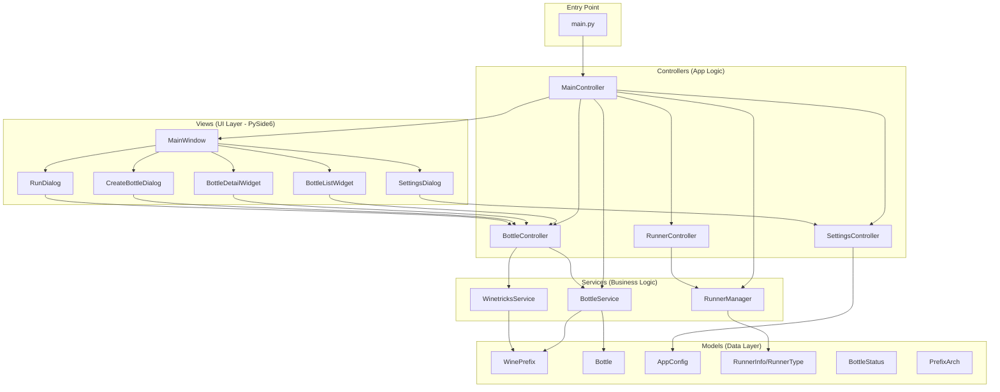
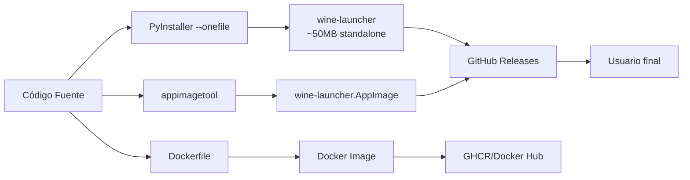

# Wine Launcher - Arquitectura MVC

> Documentación técnica de la arquitectura Model-View-Controller

---

## Diagrama General (Mermaid)



---

## Flujo de Datos

```
Usuario → View (Qt Signals) → Controller → Service → Model → Persistencia (JSON/FS)
                ↑                                    ↓
                └──────── View Update (Slots) ←──────┘
```

### 1. Inicio
```
main.py 
  → QApplication 
  → AppConfig.load() 
  → MainController(config) 
  → MainController.initialize() 
    → RunnerManager.discover_runners() 
  → MainWindow(controller) 
  → window.show() 
  → app.exec()
```

### 2. Crear Botella
```
User: Click "Nueva Botella" (Ctrl+N)
  → CreateBottleDialog.exec() 
  → BottleController.create_bottle(name, desc, runner_type, arch, runner_name)
  → BottleService.create_bottle() 
    → WinePrefix.create_new() 
    → Bottle.create_new() 
    → bottle.save(config_dir) 
  → BottleListWidget.refresh() 
  → UI updates
```

### 3. Ejecutar App
```
User: Click "Ejecutar" (Ctrl+R)
  → RunDialog.exec() → app_name
  → BottleController.run_app(bottle_name, app_name)
  → BottleService.run_app(bottle, app_name)
  → WinePrefix.run(exe, args, cwd) 
    → subprocess.Popen([wine_bin, exe], env=wine_env) 
  → Proceso Windows corriendo en segundo plano
```

### 4. Winetricks
```
User: Click "Winetricks" (Ctrl+W)
  → BottleController.get_wintricks_categories()
  → WinetricksService.get_categories()
  → User selecciona verb
  → BottleController.run_winetricks_verb(bottle, verb)
  → WinetricksService.run_verb(prefix, verb)
    → subprocess.run([winetricks, --unattended, verb], env=prefix_env)
  → Resultado → UI refresh
```

---

## Responsabilidades por Capa

### Models (`models/`)
| Clase | Responsabilidad |
|-------|-----------------|
| `WinePrefix` | Gestiona prefijo Wine: `drive_c`, registry, env vars, `run()` via subprocess |
| `Bottle` | Envuelve WinePrefix + apps instalados + config runner + winetricks + env vars |
| `AppConfig` | Config global: paths, defaults, UI settings. Load/Save JSON |
| `RunnerInfo/RunnerType` | Metadata de runners detectados |
| `BottleStatus/PrefixArch` | Enums tipados |

**Reglas**: Solo dataclasses + serialización. Sin lógica de negocio. Sin imports de Qt.

### Services (`services/`)
| Clase | Responsabilidad |
|-------|-----------------|
| `RunnerManager` | Descubre runners: system wine, proton, proton-ge, wine-ge, custom. Version probing |
| `BottleService` | CRUD botellas, run_executable, run_app, install_app, backup/restore, winetricks apply, env vars |
| `WinetricksService` | Verbs por categoría, run_verb, list_installed, uninstall_verb, get_verb_info |

**Reglas**: Lógica de negocio pura. Sin UI. Usan `subprocess`, `pathlib`, `tarfile`. Inyectan `AppConfig`.

### Controllers (`controllers/`)
| Clase | Responsabilidad |
|-------|-----------------|
| `MainController` | Coordinador principal. Lazy-load sub-controllers. Lifecycle (init/shutdown) |
| `BottleController` | API alto nivel para vistas: list/get/create/delete/run apps, winetricks, env, backup |
| `RunnerController` | List/validate/refresh runners, default runner, install helpers |
| `SettingsController` | CRUD config, path validation, defaults reset |

**Reglas**: Orquestan services. Transforman data para views. Manejan errores → exceptions.

### Views (`views/`)
| Widget | Responsabilidad |
|--------|-----------------|
| `MainWindow` | QMainWindow: splitter, menús, toolbar, statusbar, coordinación |
| `BottleListWidget` | QListWidget: lista botellas, iconos status, context menu, signals |
| `BottleDetailWidget` | QTabWidget: 5 tabs (General, Apps, Config, Winetricks, Env) |
| `CreateBottleDialog` | Modal: nombre, desc, arch, runner type/selection |
| `RunDialog` | Modal: selector app instalada O custom exe+args+cwd |
| `SettingsDialog` | Modal tabs: General paths, Appearance, Advanced |

**Reglas**: Solo Qt widgets + signals/slots. Delegan a controllers. Sin lógica de negocio.

---

## Patrones Usados

### 1. Lazy Loading Controllers
```python
@property
def bottle_controller(self):
    if self._bottle_controller is None:
        from .bottle_controller import BottleController
        self._bottle_controller = BottleController(self)
    return self._bottle_controller
```

### 2. Signals/Slots (Qt)
```python
# View emits
bottle_selected = Signal(str)

# Controller connects
bottle_list.bottle_selected.connect(self._on_bottle_selected)
```

### 3. Dependency Injection
```python
# main.py
config = AppConfig.load()
controller = MainController(config)  # Inyecta config
window = MainWindow(controller)      # Inyecta controller
```

### 4. Service Layer Separation
```python
# Controller delega a Service
def create_bottle(self, ...):
    return self.service.create_bottle(...)
```

---

## Persistencia

### Config Global (`~/.config/wine-launcher/config.json`)
```json
{
  "config_dir": "~/.config/wine-launcher",
  "bottles_dir": "~/.local/share/wine-launcher/bottles",
  "runners_dir": "~/.local/share/wine-launcher/runners",
  "backups_dir": "~/.local/share/wine-launcher/backups",
  "default_runner": "proton-ge",
  "default_arch": "win64",
  "ui_theme": "System",
  "font_size": 10
}
```

### Botella Individual (`~/.config/wine-launcher/<nombre>.json`)
```json
{
  "name": "MiJuego",
  "description": "Elden Ring",
  "prefix": {
    "path": "/home/user/.local/share/wine-launcher/bottles/MiJuego",
    "arch": "win64",
    "runner_path": "/home/user/.steam/steam/compatibilitytools.d/GE-Proton9-21"
  },
  "runner_type": "proton-ge",
  "runner_version": "GE-Proton9-21",
  "installed_apps": [
    {"name": "Elden Ring", "exe_path": "drive_c/Games/ER/eldenring.exe", "args": "", "working_dir": "drive_c/Games/ER"}
  ],
  "dxvk_enabled": true,
  "vkd3d_enabled": true,
  "winetricks": ["vcrun2019", "dxvk", "win10"],
  "env_vars": {"DXVK_HUD": "1"},
  "created_at": "2025-01-15T10:30:00",
  "updated_at": "2025-01-15T10:30:00"
}
```

---

## Extensibilidad

### Agregar Nuevo Runner Type
1. `models/app_config.py` → `RunnerType` enum
2. `services/runner_manager.py` → `_find_*_runners()`, `_probe_*()`
3. `views/create_bottle_dialog.py` → combo box options

### Agregar Nueva Pestaña en Detalle
1. `views/bottle_detail.py` → `_create_nueva_tab()`
2. `controllers/bottle_controller.py` → métodos API
3. `services/bottle_service.py` → lógica si necesaria

### Agregar Winetricks Verb
```python
# services/winetricks_service.py
VERBS = {
    "libraries": [..., "nuevo_verb"],
    ...
}
```

---

## Testing Strategy

| Capa | Enfoque |
|------|---------|
| Models | Unit tests: serialización, validación, helpers |
| Services | Integration tests: mock subprocess, temp dirs |
| Controllers | Unit tests: mock services, verify delegation |
| Views | Widget tests: pytest-qt, signal emission |

```bash
# Ejecutar tests
pytest tests/ -v --cov=wine_launcher
```

---

## Build & Distribution



---

*Arquitectura v0.1.0 | Generada desde código | [Volver al README](../README.md)*